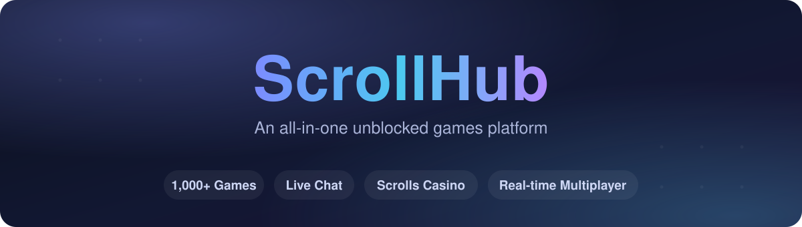

<div align="center">



<br/>

[](https://scroll-hub.onrender.com)
[](https://nodejs.org)
[](https://render.com)
[](LICENSE)

[](https://github.com/scrollreader11-dev/scroll-backend/stargazers)
[](https://github.com/scrollreader11-dev/scroll-backend/network/members)
[](https://github.com/scrollreader11-dev/scroll-backend/commits)
[](https://github.com/scrollreader11-dev/scroll-backend)

### **1,000+ games. Live chat. A full in-site economy. One server.**

*A fast, self-hosted unblocked-games platform with real-time multiplayer, built to run on free hosting.*

[**Play now**](https://scroll-hub.onrender.com) · [Features](#features) · [Deploy your own](#deploy-your-own) · [Tech](#tech-stack)

</div>

---

## Overview

**ScrollHub** bundles an entire games portal into one Node.js service: a static frontend, a game catalog that auto-syncs with upstream packs, an integrated web proxy, and a live backend powering chat, an in-site currency, a casino, and real-time multiplayer. Drop it on a host, add a couple of environment variables, and it runs.

Because the frontend and backend ship on the **same origin**, the proxy and every real-time feature work out of the box with zero cross-domain wiring.

---

## Features

| | |
|---|---|
| **1,000+ Games** | Auto-synced from upstream packs, deduplicated, with a dedicated searchable "New Games" page. |
| **Live Chat** | Real-time messages with @mentions, ping autocomplete, image & GIF sharing, and broadcasts. |
| **Scrolls Casino** | A full in-site economy: daily payouts, blackjack, slots, coinflip, case openings, and head-to-head case battles. |
| **Store & Cosmetics** | Spend Scrolls on chat tags and profile customization. |
| **Skribbl-style Draw & Guess** | Real-time multiplayer drawing game over WebSockets. |
| **Achievements & Profiles** | Unlockable achievements, unique nicknames (one per account), and live online presence. |
| **Admin Panel** | Grant Scrolls, trigger site-wide takeover modes, broadcast messages, reset nicknames. |
| **Built for free hosting** | Immutable caching, CDN offload, concurrency limits, and crash guards keep it alive on a 512MB box. |

---

## Tech Stack


| Layer | Technology |
|-------|-----------|
| Runtime | Node.js (native HTTP server, no framework) |
| Static serving | [sirv](https://github.com/lukeed/sirv) with immutable asset caching |
| Proxy | [wisp-js](https://github.com/MercuryWorkshop/wisp-js) WebSocket transport |
| Real-time | `ws` servers (chat, Skribbl, case battles) |
| Persistence | [Upstash Redis](https://upstash.com) (serverless REST) |
| Frontend | Vite + React, same-origin |

---

## Deploy your own

The whole platform deploys as a single **Web Service** (a static site won't work — the backend must run).

**1. Push to GitHub** — make sure this repo is in a GitHub repository.

**2. Create the service** on [render.com](https://render.com) → **New Web Service** → connect your repo:

| Setting | Value |
|---------|-------|
| Environment | `Node` |
| Build Command | `npm install` |
| Start Command | `npm start` |
| Instance Type | `Free` |

**3. Add environment variables** (see below). At minimum set `ADMIN_PASSWORD`.

**4. Deploy.** In ~2 minutes your portal is live at `https://<your-service>.onrender.com` — frontend, backend, games, and all.

> **Tip:** Put a free Cloudflare proxy in front for global caching — it makes the whole site dramatically faster and lets a free server handle far more players.

---

## Environment Variables

| Variable | Required | Purpose |
|----------|:--------:|---------|
| `ADMIN_PASSWORD` | Recommended | Unlocks the admin panel. Set your own; never commit it. |
| `UPSTASH_REDIS_REST_URL` | Recommended | Durable storage so chat, Scrolls, and profiles survive restarts. |
| `UPSTASH_REDIS_REST_TOKEN` | Recommended | Auth token paired with the URL above. |
| `TMDB_API_KEY` | Optional | Enables the movies section. |
| `GROQ_API_KEY` | Optional | Enables AI features. |
| `IMG_PROXY_BASE` | Optional | Image-CDN base for thumbnails (default: wsrv.nl). Set empty to serve on-origin. |
| `INCLUDE_UBG` | Optional | Set to `1` to include the GitLab game pack (hidden by default). |
| `PORT` | Auto | Set by the host. Defaults to `8080` locally. |

> Without the Upstash variables the site still runs, but player data lives in temporary storage and resets on restart.

---

## Local Development

```bash
npm install
export ADMIN_PASSWORD="choose-your-own"
npm start
# open http://localhost:8080
```

---

## Project Structure

```
scroll-backend/
├── server.js        Routing, proxy, chat, admin, catalog
├── casino.js        Scrolls economy: games, store, cases, battles
├── skribbl.js       Real-time draw-and-guess WebSocket game
├── dist/            Built frontend and static pages
│   ├── extframe.html    Cross-origin game loader
│   ├── newgames/        New Games browser
│   ├── casino/          Casino UI
│   └── admin/           Admin panel
└── package.json
```

---

## Performance

Tuned to survive on free hosting:

- **Immutable caching** on hashed assets and thumbnails
- **CDN offload** for images and the frontend bundle
- **Concurrency limits** and a bounded in-memory cache to stay within tight memory budgets
- **Crash guards** on unhandled rejections and exceptions so one bad request never takes the server down
- **Cross-origin game loading** so most game traffic never touches the origin

---

## Roadmap

- [ ] Cloudflare edge caching on a custom domain
- [ ] Expanded self-hosted game library
- [ ] More casino games and cosmetics
- [ ] Mobile layout polish

---

<div align="center">

### If ScrollHub is useful to you, drop a star — it genuinely helps.

[](https://github.com/scrollreader11-dev/scroll-backend)

</div>

---

## License

Released under the [MIT License](LICENSE) — free to use, modify, and share. If you build on it, a star or a credit back is appreciated.

**Note:** the MIT license covers ScrollHub's own source code only. Games, game assets, thumbnails, logos, and any third-party content bundled with, linked to, or proxied by this project remain the property of their respective owners and are **not** covered by this license. Third-party libraries keep their own licenses.

