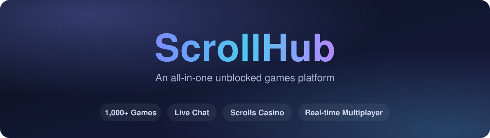

<div align="center">



<br/>

[](https://scroll-hub.onrender.com)
[](https://nodejs.org)
[](https://render.com)
[](LICENSE)

[](https://github.com/scrollreader11-dev/scroll-backend/stargazers)
[](https://github.com/scrollreader11-dev/scroll-backend/network/members)
[](https://github.com/scrollreader11-dev/scroll-backend/commits)
[](https://github.com/scrollreader11-dev/scroll-backend)

### **1,600+ games. Live chat. A full in-site economy. One server.**

*A fast, self-hosted unblocked-games platform with a Discord-style social layer, a walkable casino and real-time multiplayer, built to run on free hosting.*

[**Play now**](https://scroll-hub.onrender.com) · [Features](#features) · [Deploy your own](#deploy-your-own) · [Tech](#tech-stack)

</div>

---

## Overview

**ScrollHub** bundles an entire games portal into one Node.js service: a static front end, a game library that launches over a thousand web games, a live backend for accounts, chat and friends, a walkable casino with an in-site currency, and real-time multiplayer games. Fork it, add a couple of environment variables, and it runs.

Because the front end and backend ship on the **same origin**, every real-time feature works out of the box with zero cross-domain wiring.

---

## Features

| | |
|---|---|
| **The Hub** | A launcher-style home with a store, your library, Originals, a trophy room, news and a live site-status page. Every game has its own page with a one-click **Play now**. Themes and layout are yours to change. |
| **1,600+ games** | Web games from the open web plus ScrollHub Originals. Search, categories and "more like this" built in. |
| **Discord-style servers** | Servers, channels, DMs, friends, voice channels and calls, all inside the site. |
| **Multiplayer games** | BedWars, Scroll Royale, TNT Spleef, Scroll Racing, Capture the Flag, Prop Hunt, Duels and a draw-and-guess game, all real-time over WebSockets. |
| **Scrolls Casino** | A walkable casino world with slots, blackjack, roulette, crash, plinko, the Big Wheel, mines, dice, coinflip, case vaults and an arcade. Scrolls are an in-site currency with no real money. |
| **Cosmetics** | Skins, colors, hats, wings, particle trails, name tags and glowing names, with a wardrobe to mix and match. |
| **Accounts** | Sign up, log in, recover your password, set a unique nickname, and unlock achievements. |
| **Notifications and install** | Pop-up and push notifications, and an **Install app** option so the hub opens like an app. |
| **Moderation** | Chat filters, reports, a mod application form and staff tools. |
| **Built for free hosting** | Immutable caching, compressed responses, CDN offload, concurrency limits and crash guards keep it alive on a 512 MB box. |

---

## Tech Stack


| Layer | Technology |
|-------|-----------|
| Runtime | Node.js 18+ (native HTTP server, no framework) |
| Static serving | [sirv](https://github.com/lukeed/sirv) with immutable caching and Brotli/gzip |
| Proxy | [wisp-js](https://github.com/MercuryWorkshop/wisp-js) WebSocket transport |
| Real-time | `ws` servers (chat, calls, matches, casino world) |
| Notifications | [web-push](https://github.com/web-push-libs/web-push) |
| Persistence | [Upstash Redis](https://upstash.com) (serverless REST) |
| Front end | Plain HTML, JS and CSS served from `dist/`, same-origin |

---

## Deploy your own

The whole platform deploys as a single **Web Service**. A static site will not work, because the server has to run.

**1. Fork this repo** on GitHub (the **Fork** button, top right). Your fork is your copy.

**2. Create the service** on [render.com](https://render.com): **New** → **Web Service** → connect your fork.

| Setting | Value |
|---------|-------|
| Environment | `Node` |
| Build Command | `npm install` |
| Start Command | `npm start` |
| Instance Type | `Free` |

**3. Add environment variables** (see below). At minimum set `ADMIN_PASSWORD`, and add the Upstash pair so player data survives restarts.

**4. Deploy.** In about two minutes your site is live at `https://<your-service>.onrender.com`.

To update later, push to your fork and the host redeploys.

> **Free instances sleep.** On Render's free plan the service sleeps after about 15 minutes without visitors and takes about a minute to wake up.

### Other hosts

Any host that runs a long-lived Node.js 18+ process with WebSocket support will work, for example [Railway](https://railway.com) or [Fly.io](https://fly.io). Use `npm install` to build and `npm start` to run, and set the same environment variables. Free plans and limits change, so check each host's current terms. Static-only hosts (GitHub Pages, Netlify static, and similar) cannot run the backend.

> **Tip:** Put a free Cloudflare proxy in front for global caching. It makes the site much faster and lets a small server handle more players.

---

## Environment Variables

| Variable | Required | Purpose |
|----------|:--------:|---------|
| `ADMIN_PASSWORD` | Recommended | Password for the owner tools. Set your own and never commit it. |
| `UPSTASH_REDIS_REST_URL` | Recommended | Durable storage so accounts, chat, Scrolls and profiles survive restarts. |
| `UPSTASH_REDIS_REST_TOKEN` | Recommended | Auth token paired with the URL above. |
| `OWNER_NAMES` | Optional | Comma-separated usernames that get owner access on this site. |
| `CASINO_NPCS` | Optional | Number of pretend visitors wandering the casino floor (0 to 20, default 7). Set `0` for none. |
| `SUBMISSIONS_WEBHOOK_URL` | Optional | Discord-style webhook that pings you about player submissions. |
| `APPLICATIONS_WEBHOOK_URL` | Optional | Webhook for moderator applications (falls back to the one above). |
| `VAPID_PUBLIC_KEY` / `VAPID_PRIVATE_KEY` | Optional | Fixed keys for push notifications. Generated and stored automatically if unset. |
| `TRAFFIC_CAP_GB` | Optional | Monthly bandwidth cap used by the traffic meter (default 5). |
| `UPSTREAM_ORIGIN` | Optional | Where game files that are not bundled are fetched from. |
| `TMDB_API_KEY` | Optional | Enables the movies section. |
| `GROQ_API_KEY` | Optional | Enables AI features. |
| `IMG_PROXY_BASE` / `IMG_CDN_BASE` | Optional | Image CDN bases for thumbnails. Set empty to serve on-origin. |
| `INCLUDE_UBG` | Optional | Set to `1` to include the GitLab game pack (hidden by default). |
| `WORLD_IDLE_MS` | Optional | How long a casino player can be idle before being removed (default 120000). |
| `PORT` | Auto | Set by the host. Defaults to `8080` locally. |

> Without the Upstash variables the site still runs, but accounts and player data live in temporary storage and reset on every restart.

---

## Local Development

```bash
git clone https://github.com/scrollreader11-dev/scroll-backend
cd scroll-backend
npm install
export ADMIN_PASSWORD="choose-your-own"
npm start
# open http://localhost:8080
```

---

## Project Structure

```
scroll-backend/
├── server.js         Routing, proxy, chat, catalog and static serving
├── auth.js           Accounts, sessions and password recovery
├── discord.js        Servers, channels, DMs, friends and calls
├── casinoworld.js    The walkable casino world
├── casino*.js        Casino games, tables, arcade and the Scrolls economy
├── bedwars.js        BedWars engine (also runs other match games)
├── royale.js         Scroll Royale
├── racegame.js       Scroll Racing
├── minigames.js      Spleef, Capture the Flag, Prop Hunt and more
├── skribbl.js        Draw-and-guess game
├── chatguard.js      Chat filtering
├── siteops.js        News, status page, reports and mod applications
├── push.js           Push notifications
├── staticzip.js      Compression and WebP for static files
├── dist/             Front end: hub, casino, arcade and game pages
├── assets/           README images
└── package.json
```

---

## Performance

Tuned to survive on free hosting:

- **Immutable caching** on hashed assets and thumbnails
- **Brotli/gzip and WebP** to cut bandwidth
- **CDN offload** for images and shared libraries
- **Concurrency limits** and a bounded in-memory cache for tight memory budgets
- **Crash guards** on unhandled rejections and exceptions so one bad request never takes the server down

---

## Roadmap

- [ ] Cloudflare edge caching on a custom domain
- [ ] Expanded self-hosted game library
- [ ] More casino games and cosmetics
- [ ] More multiplayer modes

---

<div align="center">

### If ScrollHub is useful to you, drop a star. It genuinely helps.

[](https://github.com/scrollreader11-dev/scroll-backend)

</div>

---

## License

Released under the [MIT License](LICENSE) — free to use, modify, and share. If you build on it, a star or a credit back is appreciated.

**Note:** the MIT license covers ScrollHub's own source code only. Games, game assets, thumbnails, logos, and any third-party content bundled with, linked to, or proxied by this project remain the property of their respective owners and are **not** covered by this license. Third-party libraries keep their own licenses.

